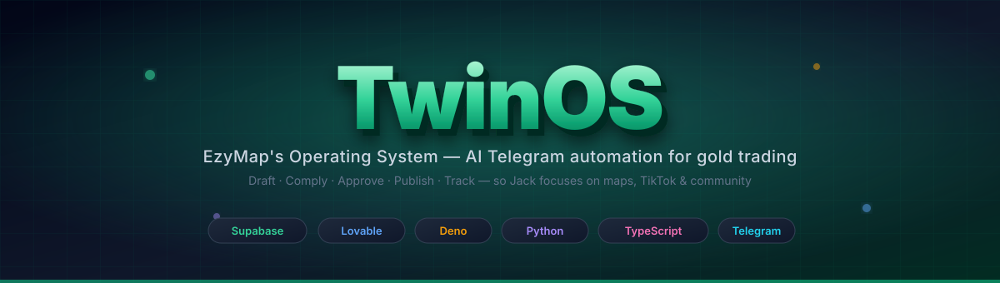
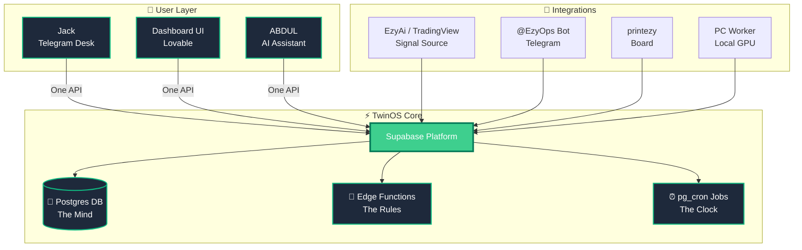
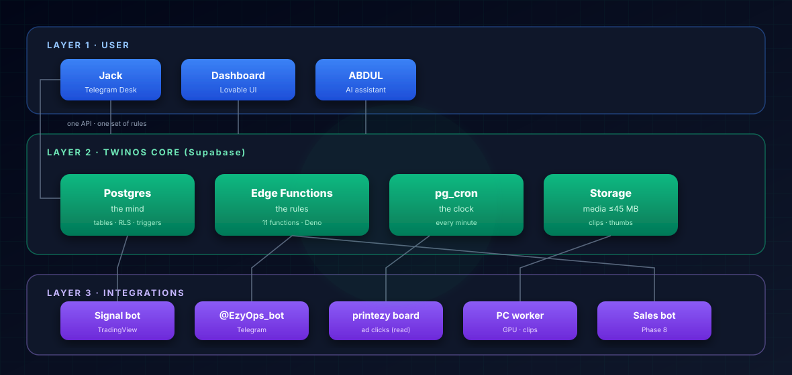
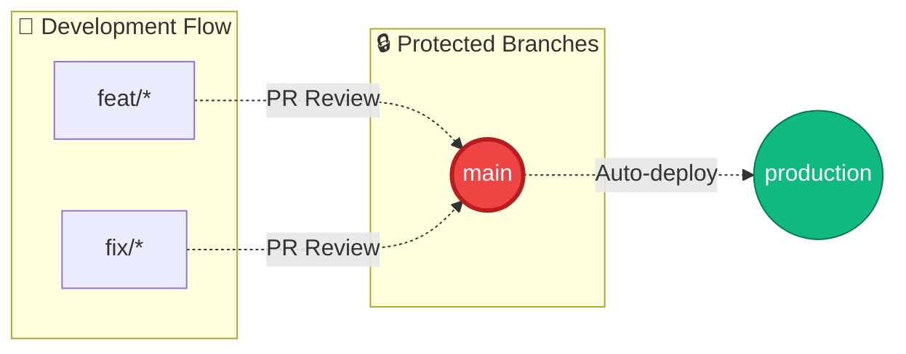

<!-- @dsCard group="TwinOS" -->
<p align="center">
  
</p>

<p align="center">
  <strong>🤖 AI-Powered Telegram Channel Automation for Gold Trading</strong><br>
  <em>Orchestrate content, compliance, publishing &amp; analytics — so Jack can focus on maps, TikTok &amp; community</em>
</p>

<p align="center">
  <a href="https://github.com/printezy247/TwinOS-helper-system/actions/workflows/ci.yml"></a>
  <a href="https://supabase.com/dashboard/project/cdnyybrfoclexjlroqcf"></a>
  <a href="https://www.typescriptlang.org"></a>
  <a href="https://www.python.org"></a>
  <a href="https://github.com/printezy247/TwinOS-helper-system/blob/main/LICENSE"></a>
  <a href="https://github.com/printezy247/TwinOS-helper-system/releases"></a>
</p>

<p align="center">
  <a href="#-what-twinos-does"></a>
  <a href="#-architecture-overview"></a>
  <a href="#-quick-start"></a>
  <a href="#-immutable-rules"></a>
</p>

---

## 📑 Table of Contents

- [🎯 What TwinOS Does](#-what-twinos-does)
- [🏗️ Architecture Overview](#-architecture-overview)
- [📁 Project Structure](#-project-structure)
- [📚 Documentation](#-documentation)
- [⚖️ Immutable Rules](#-immutable-rules)
- [🧪 Local Verification](#-local-verification)
- [🔄 Development Workflow](#-development-workflow)
- [🛠️ Tooling Stack](#-tooling-stack)
- [📊 Project Metrics](#-project-metrics)
- [🚀 Quick Start](#-quick-start)
- [💡 Contributing](#-contributing)
- [📄 License](#-license)

---

## 🎯 What TwinOS Does

<div align="center">
<table>
<tr>
<td align="center" width="33%"><strong>📝 Smart Drafting</strong><br><em>Auto-generate posts from templates</em></td>
<td align="center" width="33%"><strong>✅ Compliance Check</strong><br><em>Validate against trading rules</em></td>
<td align="center" width="33%"><strong>🎯 One-Tap Publish</strong><br><em>Jack approves, system schedules</em></td>
</tr>
<tr>
<td align="center"><strong>📊 Signal Tracking</strong><br><em>Auto-reply under signal posts</em></td>
<td align="center"><strong>👥 Member Analytics</strong><br><em>Track growth &amp; retention</em></td>
<td align="center"><strong>🏆 Friday Scoreboard</strong><br><em>Weekly performance reports</em></td>
</tr>
</table>
</div>

---

## 🏗️ Architecture Overview

### System Flow



### Three Layers, One API

<p align="center">
  
</p>

### The Eleven Edge Functions

| Function | Trigger | Purpose | Status |
|----------|---------|---------|--------|
| `content` | Dashboard, ABDUL, cron | Draft from template, request approval | ✅ Phase 0 |
| `approve` | Jack (JWT/Telegram) | **The publish gate** — Jack only | ✅ Phase 0 |
| `publish` | pg_cron (every min) | Schedule & send posts with backoff | ✅ Phase 0 |
| `tg-webhook` | Telegram Bot API | Desk input, buttons, member events | ✅ Phase 0 |
| `tv-webhook` | TradingView alerts | Signal card drafts (COUNTER-TREND line kept) | 🟡 Phase 1 |
| `signals-ingest` | Signal bot | Idempotent batch ingestion | ✅ Phase 0 |
| `results` | ABDUL, cron | Result replies under signals | 🟡 Phase 1 |
| `health` | Everyone (beats) | System health checks | ✅ Phase 0 |
| `friday` | cron, Jack, ABDUL | Weekly scoreboard | 🟡 Phase 1 |
| `jobs` | PC worker | Asset upload, Telechurn import | ✅ Phase 0 |
| `links` | Jack, ABDUL | Named invite links | ✅ Phase 0 |

---

## 📁 Project Structure

<details>
<summary><strong>📂 Click to expand full repository layout</strong></summary>

```bash
TwinOS-helper-system/
├── supabase/
│   ├── migrations/          # Schema, RLS, triggers, mint_api_key()
│   ├── seed.sql             # Settings, products, templates, brand facts
│   ├── functions/
│   │   ├── _shared/         # Auth, roles, compliance, Telegram client
│   │   ├── content/         # Draft generation & template variants
│   │   ├── approve/         # Approval workflow (Jack only)
│   │   ├── publish/         # Scheduled publishing with backoff
│   │   ├── tg-webhook/      # Telegram inbound events
│   │   ├── tv-webhook/      # TradingView alerts
│   │   ├── signals-ingest/  # Signal data extraction
│   │   ├── results/         # Performance tracking & replies
│   │   ├── health/          # System health checks
│   │   ├── friday/          # Weekly scoreboard
│   │   ├── jobs/            # PC worker claim/result
│   │   └── links/           # Invite link management
│   └── config.toml          # Supabase configuration
├── workers/
│   └── pc/
│       ├── twinos_worker.py # Local Python worker (no exposed ports)
│       ├── test_worker.py   # Worker test suite
│       └── studio/          # Clipping, transcription, thumbnails
├── bots/
│   └── ops/
│       └── README.md        # @EzyOps_bot setup guide
├── apps/
│   ├── dashboard/           # Lovable-generated UI
│   └── mcp/                 # TwinOS MCP server for ABDUL
├── docs/                    # Runbooks, contracts, specifications
├── tests/                   # Unit & integration tests
├── scripts/                 # Deployment & utility scripts
├── .github/workflows/       # CI/CD pipelines
└── LICENSE                  # MIT License
```

</details>

### Repository Layout Table

| Path | Purpose | Owner |
|------|---------|-------|
| `supabase/migrations/` | Database schema, RLS policies, triggers | Migration Agent |
| `supabase/seed.sql` | Initial data, templates, hooks | Seed Agent |
| `supabase/functions/_shared/` | Core utilities (auth, compliance, Telegram) | Scaffold |
| `supabase/functions/<fn>/` | Individual Edge Function endpoints | Scaffold |
| `workers/pc/twinos_worker.py` | Local PC Python worker (no exposed ports) | Scaffold |
| `bots/ops/` | @EzyOps_bot configuration & deployment | Scaffold |
| `apps/dashboard/` | User-facing dashboard (Lovable) | Lovable |
| `apps/mcp/` | MCP protocol integration for ABDUL | MCP Agent |
| `tests/` | Comprehensive test coverage | — |
| `scripts/*.sh` | Automation scripts (deploy, keys, desk-tour) | — |
| `.github/workflows/ci.yml` | CI: Deno check/lint/tests, Python unittest | — |

---

## 📚 Documentation

<div align="center">

| Document | Description | Phase |
|----------|-------------|-------|
| [`SETUP.md`](docs/SETUP.md) | Phased setup guide (Jack-only commands) | All |
| [`ARCHITECTURE.md`](docs/ARCHITECTURE.md) | System shape + 11 Edge Functions | Plan |
| [`API.md`](docs/API.md) | Endpoints with request/response examples | Plan |
| [`PHASES.md`](docs/PHASES.md) | Phase-by-phase implementation checklist | All |
| [`UPGRADE-IDEAS.md`](docs/UPGRADE-IDEAS.md) | Research-driven enhancements (Wave 5+) | Future |
| [`LOVABLE-KNOWLEDGE.md`](docs/LOVABLE-KNOWLEDGE.md) | Lovable project knowledge base | Dashboard |
| [`UPGRADE-PLAN.md`](UPGRADE-PLAN.md) | Full development roadmap (v3.1) | Plan |
| [`bots/ops/README.md`](bots/ops/README.md) | @EzyOps_bot operational guide | Phase 0 |
| [`workers/pc/README.md`](workers/pc/README.md) | PC worker documentation | Phase 1 |

</div>

---

## ⚖️ Immutable Rules

These rules are non-negotiable and govern all TwinOS operations:

<div align="center">

| Rule | Enforcement | Why |
|------|-------------|-----|
| 🔒 **Approve is Jack only** | Dashboard requires his login or Desk group Telegram ID; ABDUL cannot approve | Human judgment gate |
| 🗄️ **Schema first** | Lovable never creates tables; UI always calls functions | Backend ownership |
| 🔐 **No secrets in files** | Tokens → Supabase function secrets; machine keys hashed in `api_keys`; Jack's copies in keyring (`secret-tool`) | Security boundary |
| ✅ **Allowed methods only** | Bot API, official APIs, Telechurn reports, manual entry — no scraping or group text AI | Platform compliance |
| 🎭 **Demo/shadow signals private** | Never reach public posts | Privacy preservation |

</div>

---

## 🧪 Local Verification

Run these commands before committing changes:

```bash
# TypeScript validation (edge functions)
cd supabase/functions && \
  deno check --config deno.json _shared/*.ts */index.ts && \
  deno lint --config deno.json && \
  deno test --config deno.json --allow-env _shared/

# Python unit tests (PC worker)
cd workers/pc && python3 -m unittest discover -v -p "test_*.py"

# Cross-file consistency (CI gate)
python3 tests/check_consistency.py

# Script tests
python3 -m unittest discover -v -s tests -p "test_*.py"

# Secret key rotation checks (lists active keys, masks values)
./scripts/mint-keys.sh --list

# Desk tour validation
./scripts/desk-tour.sh --dry-run
```

---

## 🔄 Development Workflow

### Branch Protection Strategy



### PR Guidelines

1. **Create feature branch** from `main`
2. **Implement changes** with test coverage
3. **Run local checks** (see above)
4. **Open Pull Request** targeting `main`
5. **Await review** from designated reviewers
6. **Merge to main** after approval
7. **Deploy via script**: `./scripts/deploy.sh`

> ⚠️ **Warning:** Direct pushes to `main` skip review. Always use the PR workflow.

---

## 🛠️ Tooling Stack

| Category | Tools | Purpose |
|----------|-------|---------|
| **Backend** | Supabase Postgres, Edge Functions (Deno), pg_cron | Serverless APIs, scheduled jobs |
| **Frontend** | Lovable (TypeScript + Tailwind + shadcn/ui) | Dashboard UI |
| **Automation** | Python workers, Telechurn API, Telegram Bot API | Local processing, integrations |
| **Testing** | Deno Test, Python unittest | Unit & integration tests |
| **CI/CD** | GitHub Actions, Supabase CLI | Continuous integration & deployment |
| **Monitoring** | Action logs, Error tracking, Health checks | System observability |

---

## 📊 Project Metrics

<div align="center">

| Metric | Value |
|--------|-------|
| **Languages** | TypeScript, Python, SQL |
| **Frameworks** | Supabase, Lovable, Deno |
| **Primary** | Backend (Python + Deno) |
| **Tests** | Unit + Integration |
| **License** | MIT |
| **Status** | Phase 1 (Desk Loop) |

</div>

---

## 🚀 Quick Start

### Prerequisites

- ✅ Supabase account (Jack's project: `cdnyybrfoclexjlroqcf`)
- ✅ Node.js v22+ (for Deno edge functions)
- ✅ Python 3.12+ (for PC worker)
- ✅ GitHub account (for TwinOS repo access)

### Installation Steps

See [`docs/SETUP.md`](docs/SETUP.md) for the complete phased installation guide.

**TL;DR:**

```bash
# Clone repository
git clone https://github.com/printezy247/TwinOS-helper-system.git
cd TwinOS-helper-system

# Install Supabase CLI
npm install -g supabase

# Initialize local dev environment
supabase link --project-ref cdnyybrfoclexjlroqcf

# Start local services
supabase start

# Run all tests (see Local Verification above)
cd supabase/functions && deno check --config deno.json _shared/*.ts */index.ts
cd ../../workers/pc && python3 -m unittest discover -v -p "test_*.py"
```

---

## 💡 Contributing

This repository is actively maintained by Jack. For contributions:

1. Open an issue describing the enhancement or bug
2. Fork the repository
3. Create a feature branch
4. Submit a pull request

For major changes, please read [`docs/UPGRADE-IDEAS.md`](docs/UPGRADE-IDEAS.md) first to align with the vision.

---

## 📄 License

MIT License — see [`LICENSE`](LICENSE) for details.

---

<div align="center">

### Made with ❤️ by Jack for EzyMap trading operations

**Powered by** [Supabase](https://supabase.com) · [Lovable](https://lovable.dev) · [GitHub Actions](https://github.com/features/actions)

[](https://github.com/printezy247/TwinOS-helper-system/stargazers)
[](https://github.com/printezy247/TwinOS-helper-system/watchers)
[](https://github.com/printezy247/TwinOS-helper-system/fork)

[📖 Full Documentation](#-documentation) • [⚙️ Setup Guide](docs/SETUP.md) • [🎯 Roadmap](docs/PHASES.md)

</div>